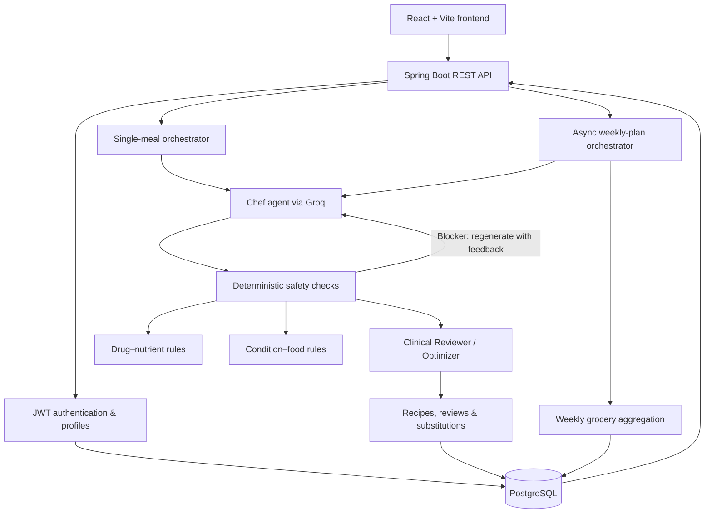

# Pathyana

### AI-powered meal planning with a deterministic nutrition safety layer

Pathyana is a full-stack nutrition planning application that combines **multi-agent recipe generation** with **rule-based food-safety checks**. It personalizes meal recommendations using dietary preferences, allergies, health conditions, medications, and eating schedules, while explicitly identifying cases that its safety rules do not cover.

Rather than relying on an LLM alone to decide whether a recipe is suitable, Pathyana separates **generation**, **deterministic verification**, and **advisory review**. The application supports on-demand meals and asynchronously generated seven-day plans with aggregated grocery lists.

> **Important:** Pathyana is an educational prototype, not a medical device or a substitute for a clinician or registered dietitian. Its rule databases are limited, model outputs may be inaccurate, and absence of a flagged interaction does not establish that a meal is safe.

## Key features

- **Personalized profiles:** Capture dietary preferences, favorite and avoided foods, allergies, health conditions, medications, preferred cuisines, health goals, and eating-window constraints.
- **Multi-agent meal generation:** A Chef agent proposes recipes, a Clinical Reviewer adds advisory context, and an Optimizer agent participates in the recipe refinement pipeline.
- **Deterministic safety checks:** Separate rule engines evaluate supported drug–food and condition–food interactions; detected blockers can trigger recipe regeneration.
- **Transparent safety coverage:** Exposes which drugs and conditions have encoded rules instead of implying comprehensive clinical validation.
- **Ingredient substitutions:** Supports rule-informed ingredient swaps in the meal-planning workflow.
- **Seven-day planning:** Generates a weekly plan asynchronously, with lightweight status polling and progress feedback in the UI.
- **Consolidated groceries:** Aggregates grocery requirements across the weekly plan.
- **Accounts and protected routes:** Email-based signup verification, JWT authentication, persistent profiles, and user-scoped plan access.

## Architecture



**How meal generation works**

1. The backend assembles profile context from the authenticated user's preferences and restrictions.
2. The Chef agent proposes a structured recipe through the Groq API.
3. Independent rule engines evaluate ingredient interactions against *supported* medications and health conditions.
4. Blocking findings provide feedback to regenerate the recipe; the single-meal orchestrator allows up to two regenerations.
5. A reviewer and optimizer add advisory feedback and refinement; generated output and safety-related information are returned to the UI.
6. The frontend displays recipe details and coverage indicators so users can see when a medication or condition is outside the encoded rules.

This is a **hybrid AI + rules architecture**, not a medically validated safety guarantee. The code contains a finite set of encoded interactions, and the LLM reviewer is advisory.

## Tech stack

| Layer | Technologies |
| --- | --- |
| Frontend | React 19, JavaScript, Vite 8, React Router 7, Tailwind CSS 3, Axios |
| Backend | Java 17, Spring Boot 3.5, Spring Web, Spring Security, Spring Data JPA, Hibernate |
| Database | PostgreSQL |
| AI integration | Groq Chat Completions API; configured model: `llama-3.3-70b-versatile` |
| Authentication | JWT (JJWT), BCrypt password hashing, email verification via SMTP |
| Async processing | Spring `@Async`-based weekly generation, status polling |
| Build & tooling | Maven Wrapper, npm, ESLint |

## Repository structure

```text
.
├── pathyana-backend/
│   ├── pom.xml
│   └── src/
│       ├── main/java/com/pathyana/api/
│       │   ├── config/              # Security, JWT filtering, password config
│       │   ├── controller/          # Auth, profile, meals, weekly plans, coverage
│       │   ├── dto/                 # Request and response contracts
│       │   ├── llm/                 # Groq client, retries and error handling
│       │   ├── model/               # JPA entities
│       │   ├── repository/          # Persistence interfaces
│       │   └── service/
│       │       ├── orchestration/   # Agent pipeline, weekly plans, groceries
│       │       ├── profile/         # Profile operations
│       │       └── safety/          # Interaction rules and ingredient swaps
│       └── main/resources/application.properties
├── pathyana-frontend/
│   ├── package.json
│   └── src/
│       ├── components/              # Meals, profile and weekly-plan widgets
│       ├── context/                 # Authentication context
│       ├── lib/                     # API clients and UI configuration
│       ├── pages/                   # Landing, auth, profile, meals, weekly plan
│       └── App.jsx                  # Client-side routes
└── README.md
```

## Running locally

### Prerequisites

- **Java 17**
- **Node.js and npm** compatible with the installed Vite version
- **PostgreSQL** (local installation or Docker)
- **Groq API key** for meal generation
- **SMTP credentials** for email verification during signup

### 1. Create the database

The checked-in development configuration expects PostgreSQL at `localhost:5432` with database `pathyana_db` and user `pathyana`.

For a disposable **local development** database, one option is:

```bash
docker run --name pathyana-pg \
  -e POSTGRES_DB=pathyana_db \
  -e POSTGRES_USER=pathyana \
  -e POSTGRES_PASSWORD=pathyana_dev \
  -p 5432:5432 \
  -d postgres:16
```

These credentials match the repository's **development-only** defaults. Do not reuse them in deployment. The current `application.properties` specifies database credentials directly; replace them with environment-based settings before deploying.

### 2. Configure the backend

Export the secrets required by the checked-in application configuration:

```bash
export GROQ_API_KEY="your-groq-api-key"
export PATHYANA_JWT_SECRET="replace-with-a-random-secret-at-least-32-characters"
export PATHYANA_MAIL_USERNAME="your-smtp-account@gmail.com"
export PATHYANA_MAIL_PASSWORD="your-gmail-app-password"
```

The configured SMTP provider is Gmail (`smtp.gmail.com:587`) with STARTTLS. A Gmail app password may be required for the configured flow. Groq requests will fail without `GROQ_API_KEY`; signup email delivery needs a working SMTP configuration. Use a securely generated JWT signing secret, not the placeholder above.

From the repository root:

```bash
cd pathyana-backend
./mvnw spring-boot:run
```

On Windows, use `mvnw.cmd spring-boot:run` instead. By default the API runs at **http://localhost:8080**. Development schema updates are configured with `spring.jpa.hibernate.ddl-auto=update`; use managed migrations before production deployment.

### 3. Start the frontend

In a separate terminal:

```bash
cd pathyana-frontend
npm install
npm run dev
```

Open the local address printed by Vite (normally **http://localhost:5173**).

The Axios API client defaults to `http://localhost:8080`. To override it, create `pathyana-frontend/.env.local`:

```dotenv
VITE_API_BASE_URL=http://localhost:8080
```

The backend currently permits local development CORS origins `http://localhost:3000` and `http://localhost:5173`.

### 4. Use the application

1. Sign up and verify your email using the link sent by the backend.
2. Log in to obtain a JWT.
3. Complete your nutrition profile, including restrictions and medication information.
4. Generate a meal or start a weekly plan.
5. Review the recipe, disclosed safety coverage, progress information, and grocery list.

## API overview

Most routes require `Authorization: Bearer <token>`. Authentication and development test routes are public in the current security configuration.

| Method | Endpoint | Purpose |
| --- | --- | --- |
| `POST` | `/api/auth/signup` | Create an account and send verification email |
| `GET` | `/api/auth/verify?token=...` | Verify email address |
| `POST` | `/api/auth/login` | Authenticate and receive JWT |
| `GET` | `/api/profile` | Read current user's profile |
| `POST` | `/api/profile/seed` | Create or replace profile details |
| `POST` | `/api/meals/generate` | Generate an on-demand personalized meal |
| `POST` | `/api/meals/weekly/generate` | Start asynchronous seven-day plan generation |
| `GET` | `/api/meals/weekly/active` | Get the active weekly plan |
| `GET` | `/api/meals/weekly/{id}/status` | Poll generation status |
| `GET` | `/api/meals/weekly/{id}` | Get a specific weekly plan |
| `GET` | `/api/meals/weekly/{id}/grocery` | Get its consolidated grocery list |
| `GET` | `/api/safety/coverage` | List encoded medication and condition coverage |
| `GET` | `/api/safety/check-drug?name=...` | Check whether drug-specific rules exist |
| `GET` | `/api/test/ping` | Development connectivity check |
| `POST` | `/api/test/groq` | Development Groq connectivity check |

### Example: request a meal

```bash
curl -X POST http://localhost:8080/api/meals/generate \
  -H "Authorization: Bearer YOUR_JWT" \
  -H "Content-Type: application/json" \
  -d '{"userRequest":"Suggest a high-protein vegetarian lunch"}'
```

### Example: generate a weekly plan

```bash
curl -X POST http://localhost:8080/api/meals/weekly/generate \
  -H "Authorization: Bearer YOUR_JWT" \
  -H "Content-Type: application/json" \
  -d '{"startDate":"2026-11-16","userRequest":"Prefer simple home-cooked meals"}'
```

The weekly endpoint returns `202 Accepted` with a plan status record. The frontend polls `/api/meals/weekly/{id}/status` while generation proceeds. Possible statuses include `PENDING`, `GENERATING`, `COMPLETED`, `PARTIAL`, and `FAILED`.

## Engineering considerations

**Separation of generation and verification.** Recipes are generated by an LLM, but supported hard constraints are checked in Java rule engines. Blocking findings can trigger feedback-driven regeneration rather than being left to the language model's judgment alone.

**Coverage transparency.** The API publishes rule coverage so the UI can distinguish an encoded check from an unrecognized medication. “Not flagged” is not the same as “verified safe.”

**Resilience to model-provider errors.** The Groq client includes timeouts and retry/backoff handling for rate limits and transient server failures. Weekly generation adds pacing between meal requests.

**Responsive long-running workflows.** Weekly-plan creation dispatches work through a separate asynchronous runner and exposes a lightweight progress endpoint, keeping long model-generation work out of the initial HTTP request.

**User-scoped data access.** JWT-based backend authentication protects application routes, and weekly-plan retrieval checks that the requested plan belongs to the authenticated user.

## Development commands

```bash
# Backend tests (from pathyana-backend/)
./mvnw test

# Frontend static analysis (from pathyana-frontend/)
npm run lint

# Frontend production bundle
npm run build

# Preview production bundle locally
npm run preview
```

The repository includes a Spring Boot application test scaffold; it does **not** establish broad automated coverage of the clinical rules, orchestration behavior, or end-to-end flows.

## Limitations and future improvements

- **Clinical validation:** Current rules are manually encoded and incomplete; clinical accuracy, safety, and efficacy have not been demonstrated by this repository.
- **Security hardening:** Review the use of JWTs in browser `localStorage`, remove public development test endpoints, apply stricter production CORS, and protect sensitive profile data appropriately.
- **Configuration:** Move development database credentials and deployment-specific values into environment-backed configuration.
- **Persistence:** Replace development-time Hibernate schema updates with versioned database migrations.
- **Reliability:** Add comprehensive unit, integration, and end-to-end tests, especially for safety rules and regeneration logic.
- **Operational readiness:** Add observability, deployment configuration, and systematic failure recovery for long-running weekly jobs.

## Disclaimer

Pathyana provides personalized meal-planning suggestions for educational purposes. It does not diagnose or treat conditions, prescribe diets, or certify food–medication safety. Users should consult a qualified healthcare professional for medical nutrition or medication-related guidance.
